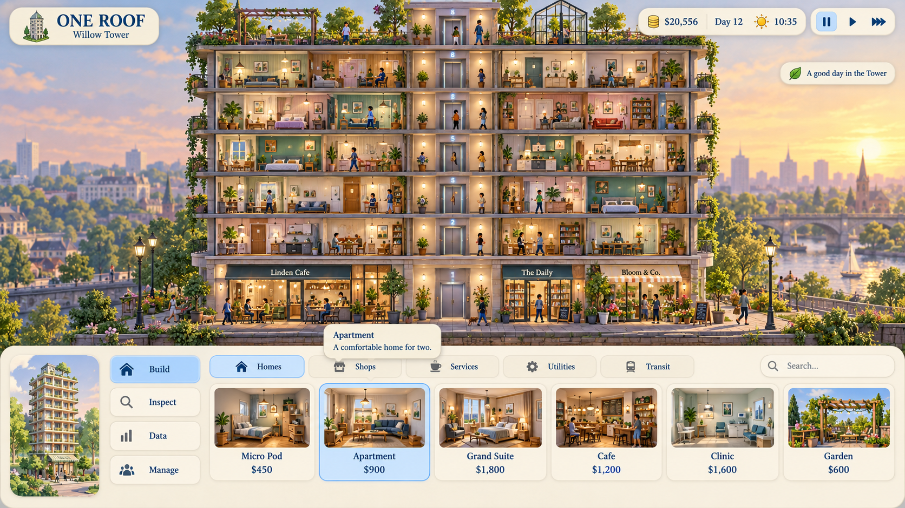

# One Roof — Relaxed UI design specification

Date: 2026-10-02. Status: visual direction selected by the Steward's human designer; implementation pending.

## 1. Design decision and authority

The selected reference is the **first ivory-and-blue concept**, with a Tower illustration at bottom left, a vertical four-mode rail, a wide thumbnail catalog, and time controls at top right. It is not the later two-by-two mode layout or the dark blueprint concept.

This specification owns the new shell's appearance and interaction design. [UX and Gameplay](../UX_AND_GAMEPLAY.md) remains authoritative for gameplay, overlays, inspectors and the cause-chain contract. Where the visual reference omits a feature, preserve that feature through the rules below. Numerical design values are proposed implementation targets, not measured runtime results.

The image establishes UI composition and mood. Its Tower art, room names, prices, rooftop gardens and positive notice are illustrative: they do not authorize new gameplay, economy tuning, room types or world-art replacement. All shipping entries and values come from existing catalogs and projections. Sims 3 is a tonal influence; use original artwork, icons and licensed fonts.

## 2. Experience goals

The Tower should feel welcoming, inhabited and easy to observe. The interface sits at its edges, offering clear choices without covering daily life. Relaxed presentation must still expose real hardship and urgent decisions.

- Keep a large continuous world viewport, with a shallow bottom dock.
- Use warm opaque surfaces, soft blue selection, modest depth and readable dark text.
- Favor illustrated items and everyday explanations over walls of numbers.
- Reveal detail through selection, tabs and expansion; keep important problems discoverable.
- Preserve the Steward's systems-level role. Resident inspection never becomes individual movement or schedule control.

## 3. Layout and responsive behavior

All sizes below are logical pixels at 1920×1080 and 100% UI scale. Use shared layout calculations for rendering, camera framing and pointer exclusion; do not duplicate hard-coded bounds across controllers.

| Region | Target and behavior |
|---|---|
| Tower identity | Top left, 16 px margin, approximately 320×80. Small Tower illustration, ONE ROOF wordmark and projected Tower name. Long names ellipsize with a full-name tooltip. |
| Global status | Top right, 16 px margin. Treasury, day, time/weather, followed by pause and speed controls. Stable widths prevent clock or balance updates shifting buttons. |
| Notices | Below global status, aligned right; at most two compact cards, with overflow in an event list. Avoid the inspection panel. |
| Bottom dock | Full width, bottom anchored; approximately 300 px high in expanded Build mode. Opaque ivory surface, rounded upper corners, subtle border. |
| Tower illustration | Approximately 190 px wide inside dock, with 16 px padding. Decorative miniature; no minimap behavior implied. |
| Mode rail | Approximately 190 px wide beside illustration. Four vertical buttons: Build, Inspect, Data, Manage. Buttons roughly 56 px high, 12 px gaps. |
| Active content | Remaining dock width. Category/search header approximately 48 px; one row of thumbnail cards approximately 200 px high. Horizontal scrolling provides access to additional entries. |
| World viewport | Actual unobscured region above dock and outside expanded cards. Home framing and camera zoom must account for this region. |

At 1600×900, show fewer catalog cards instead of reducing text. At 1280×720, reduce or hide the decorative Tower illustration first; keep the vertical mode rail, scrollable catalog and readable labels. At larger UI scales, allow the dock to grow but target at least 60% unobscured screen height; collapse thumbnail height and decoration before clipping controls. Do not silently cap the requested text scale. Test 100%, 125%, 150% and 200%; a compact single-item catalog is acceptable at the smallest effective viewport. Support ultrawide layouts without stretching cards.

Inspect, Data and Manage retain the same mode rail and replace the catalog content. With no active detail or palette, allow a compact dock around 88 px high containing the mode controls in a compact accessible arrangement and a labeled Expand control. The expanded Build layout remains the primary reference; collapsed arrangements must preserve mode order. Remember expansion per mode during a session. The dock must not automatically expand on ordinary simulation updates.

## 4. Visual system

| Token | Initial value | Use |
|---|---|---|
| Surface | `#F7F0DF` | Dock, cards, header pills |
| Raised surface | `#FFF9ED` | Buttons, tooltips |
| Ink | `#173A58` | Primary text and icons |
| Secondary ink | `#526273` | Supporting labels |
| Selection | `#C5E2FA` | Selected mode, category and item |
| Selection edge | `#428BC7` | Selected outlines and focus treatment |
| Divider | `#D6CDBB` | Quiet separators; not essential state encoding |
| Positive ink | `#386B3C` | Positive text with glyph |
| Caution ink | `#805414` | Caution text with glyph |
| Critical ink | `#A43232` | Urgent text with glyph |

Validate actual rendered text contrast before shipping; target 4.5:1 for normal text and 3:1 for large text and meaningful control boundaries. Adjust tokens if needed. The reference's soft palette is not evidence of accessibility compliance.

Use an 8 px spacing rhythm, 16–20 px panel padding, 8–12 px internal gaps, 12–16 px card radii and approximately 24 px outer dock radii. Shadows are faint and compact; use reusable nine-slice surfaces rather than many layered translucent effects. World content must not bleed through text surfaces.

Typography: a licensed readable serif for the wordmark and optional item titles, paired with a clear sans-serif for numbers, paragraphs and dense detail. Starting sizes: wordmark 28–32, section/title 20–22, body and controls 18, secondary labels 16. Use tabular numerals for clock and treasury. No essential text below 16 logical px. Font fallback, punctuation and long translated strings require QA.

Icons share stroke weight, optical size and palette. Always label primary modes and categories. Selected state uses fill plus outline; keyboard focus has a distinct strong ring. Disabled items retain readable labels and a reason. Hover subtly raises contrast; press visibly depresses the surface. Color alone never indicates danger, selection or availability.

## 5. Build mode

### Catalog and mapping

Reference-facing tabs: Homes, Shops, Services, Utilities, Transit. Map existing tools to these tabs without changing command identity. Structure/floor construction, removal, undercity excavation and brushes must remain reachable through explicit **Structure** and **More tools** entries or additional tabs when space allows. Do not lose tools while simplifying the existing Space & Use / Services / Utilities / Movement & Removal grouping.

Each card contains a consistent illustration crop, display name, projected cost and optional capacity/footprint summary. Selected cards use blue fill and outline. The mockup's Micro Pod, Apartment, Grand Suite, Cafe, Clinic and Garden are examples; only expose supported tools. Search filters available catalog labels and tags locally; show a clear empty result and Reset action. Category and search selection must not issue commands.

Thumbnails should depict actual room content and capacity, not promise furnishings or functions absent from the game. Reuse cached art; never render a live camera for every catalog card. Missing art uses a themed icon and label.

### Placement flow

1. Choose an item. Show a short description tooltip on hover or focus, with cost and footprint in the expanded preview.
2. Enter placement using the existing tool session. Keep its selected identity visible and retain an explicit Change tool / Cancel control. Catalog may collapse to recover world space.
3. Move over the Tower. Preview validity, reachability, price and predicted consequences using `TowerSimulation.CanExecute()`.
4. Confirm a valid placement through the existing validated command. Invalid placement shows a specific reason, such as missing utility connection or insufficient treasury; no silent failure.
5. Preserve current repeat-placement behavior where supported. Escape cancels placement before leaving the mode. Switching mode clears the active placement ghost and prevents pending clicks from leaking into the world.

Destructive tools have a distinct warning glyph, affected-scope preview and the existing confirmation rules. Soft styling must not make demolition indistinguishable from construction. Existing placement feedback and undercity prerequisites remain visible.

## 6. Inspect mode

Dock content shows a compact selected-entity summary: identity, current activity or room use, wellbeing/operating state and a plain-language primary symptom. No selection shows “Select a Resident, room or system to learn more.”

Expand a detail card above the dock or on the right, avoiding notices. Group detail into **Now**, **Causes**, and **Responses**. Preserve links to household, workplace, faction and relevant systems. Allow close and back navigation without losing context. Deletion or disappearance of the selected entity produces a clear unavailable state instead of stale data.

Every important problem supports the complete cause-chain: world symptom → overlay → inspector cause → systems response → measured feedback. Example: “Getting home takes too long” → elevator wait overlay → insufficient shaft capacity → navigate to transit improvements → compare subsequent projected wait metrics. Resident cards observe autonomous lives; no individual command buttons.

## 7. Data mode

Replace the Build cards with a labeled overlay selector and a compact legend. Provide all eight existing overlays: elevator wait, foot traffic, population, satisfaction, noise, business health, faction tension and utilities. Expose scrutiny through its existing inspection path; do not invent a ninth overlay.

Selected overlay is unmistakable and has a Clear overlay action. Preserve existing persistence/reset semantics unless a separate implementation decision changes them. Legends pair color with units, patterns, glyphs or directional cues. Keep flow paths, utility lines and financial badges distinct; do not turn all overlays into heatmaps. Selecting an affected region leads to the relevant cause breakdown.

## 8. Manage mode

Use readable section tabs for treasury, leases, policies and existing staff/decision features. A summary appears before detailed tables. Long lists scroll inside the active panel; mode and global controls remain reachable.

Policy changes show current and proposed values, costs and known projected consequences before dispatch. Respect existing validation, confirmation, onboarding and decision-record behavior. Preserve access to Learned Wit/Word Battle and existing Caretaker entry points in their supported contexts. Specialist panels may use the same surfaces and type without being redesigned in the first slice.

## 9. Time, notices and input

Top-right controls show the true paused/running state and all supported speeds: pause, 1x, 2x, 3x. Compact icons have tooltips and accessible labels. Resume uses the existing session speed behavior. Opening a catalog or ordinary inspector must not change time implicitly. Modal pause ownership follows current session rules; closing one modal must not override another pause owner.

Notices have severity icon, concise title, timestamp and an inspect/navigation action when relevant. Positive flavor notices appear only for supported events; “A good day in the Tower” is illustrative, not a fake City Status gate. Routine notices may expire after approximately six seconds and remain in history; critical unresolved issues retain a compact indicator and event-list entry. Coalesce repeat events by stable subject and cause. Avoid continuous happy notices or full-screen alerts.

Keep existing 1–4 mode shortcuts, camera WASD/arrows, F facade lock, Home overview and F6 weather preview. Display actual speed bindings from the current input configuration; do not invent conflicting keys. Typing into search suppresses gameplay shortcuts. Tab/Shift-Tab move focus predictably; Enter/Space activate buttons; Escape closes the top interaction layer first. Hover and focus expose the same information. Scrolling a panel never zooms the Tower. Pointer clicks, drags and releases starting over UI cannot place or select world entities behind it.

## 10. Motion and accessibility

Use restrained 120–180 ms hover/focus transitions and 180–240 ms panel expansion. Avoid bounce, flashing, idle pulsing and constant animated decorative thumbnails. Reduced-motion settings replace movement with immediate state changes or a brief fade. Essential notices remain understandable without sound.

Minimum interactive targets are 44×44 logical px where feasible. Provide keyboard access to every core action, persistent focus indication, adjustable UI scale and glyph/text equivalents. Tooltip bounds clamp to the usable viewport and avoid covering the focused action. Test readability over bright sky, dark interiors and active overlays. Tooltips and help cannot be the sole source of a validation error or urgent state.

## 11. Implementation boundaries and sequence

Current evidence: `StewardTheme.cs` provides cached dark IMGUI styles and flat textures; `ModeShellBarController.cs` owns fixed shell/palette bounds, hotkeys and pointer exclusion. These are integration points, not proof that a palette-only change delivers this mockup. Inspect specialized panel owners before moving their bounds.

Keep Domain and Application engine-free. Bind views to immutable projections and stable IDs; validate simulation commands through existing boundaries. No per-Resident Update loops, scene references in saves, or UI-derived simulation outcomes. UI selection, search and expansion are presentation/session state; new persistence requires an explicit separate decision.

1. **Shell foundation:** shared layout and theme tokens, ivory panels, identity/status headers, vertical mode rail, UI scale and matching input exclusion. Keep all existing features reachable.
2. **Build catalog:** category mapping, cached thumbnails, search, card states and placement preview integration.
3. **Inspect and Data:** summary/detail hierarchy, legends and full cause-chain navigation.
4. **Manage and specialist parity:** treasury/policy/lease panels, onboarding, decision history and specialist entry points.
5. **Polish and verification:** notices, responsive behavior, keyboard focus, reduced motion and performance evidence.

Prefer evolving the existing presentation architecture for the first slice. Choose IMGUI extension versus a retained UI migration only after assessing font, focus, nine-slice and scaling needs; this document does not mandate a framework migration. Keep styling centralized. Cache textures, fonts, thumbnails and layouts; refresh content on meaningful projection changes. Measure allocations and draw impact in the live project before setting any new UI budget. Preserve existing <4 ms simulation tick / 60 FPS presentation goals.

## 12. Acceptance and evidence

| Scenario | Required result |
|---|---|
| Selected reference comparison | Build view retains left miniature, vertical mode rail, wide room-card row, top-right economy/time and ivory/blue styling. Capture at 1920×1080. |
| Responsive/scaled UI | At 1920×1080, 1600×900, 1280×720 and ultrawide, with 100–200% scale, essential controls remain readable and reachable; no overlap or clipped prices/errors. |
| Catalog completeness | Every pre-existing build tool, including structure, removal and undercity brushes, remains reachable; search/no-results and missing thumbnails work. |
| Placement and input | Valid/invalid/repeated placements behave correctly; clicks and scrolls over UI never affect the world; focus blocks camera/mode shortcuts while typing. |
| Cause-chain | Demonstrate one real transit and one real utility issue from world cue through overlay, cause, response and subsequent measured feedback. |
| Time/modal behavior | Pause/speed state matches the simulation; nested modal ownership and mode changes do not accidentally resume or place. |
| Entity and event lifecycle | Removed selections, empty catalogs, long names, repeated notices and critical unresolved issues remain coherent. |
| Accessibility | Core flows complete by keyboard; focus/selected/disabled states distinguishable without color; contrast checked on rendered surfaces; reduced motion honored. |
| Feature parity | Eight overlays, facade/overview controls, decrees, leases, onboarding, decision records and specialist entry points remain available. |
| Reference scale | Record actual HUD-on overview and close views at 30 floors/300 Residents: frame time, UI/draw impact and allocations. No performance certification from concept art. |

Run appropriate shell, placement/input and inspector regression checks during implementation, plus actual graphical captures. Document baseline failures separately. This design delivery changes documentation only: **Unity compilation, tests and performance validation were not run.**

## 13. Decisions still needed before production polish

- Final licensed font pair and thumbnail/icon asset pipeline.
- Exact tool-to-category inventory and names, verified against the runtime catalog.
- UI framework choice after a small shell prototype.
- Final collapse rules and notice timing after usability testing.

These do not block the shell foundation. The selected composition and relaxed visual direction are approved; runtime delivery and the above acceptance evidence remain pending.
